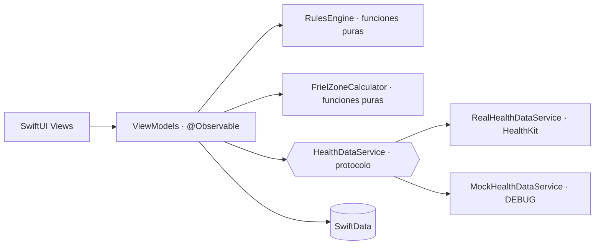

# RunnerTrack iOS

App iOS nativa para corredores principiantes que siguen un plan estructurado hacia una carrera objetivo (10K, media maratón o maratón). Calcula zonas de frecuencia cardíaca con el método Friel y avisa de señales de fatiga a partir de la FC en reposo y la HRV.

> Proyecto personal en desarrollo activo (Fase 1). La app funciona 100 % offline: no hay backend obligatorio.

## Estado

| Área | Estado |
|---|---|
| Onboarding (datos, objetivo, disponibilidad) | Hecho |
| Dashboard: cuenta atrás, zonas, semana actual, alerta | Hecho |
| Plan semanal S01 y registro de sesiones (SwiftData) | Hecho |
| Métricas: progresión de ritmo Z2 con Swift Charts | Hecho |
| Perfil editable con zonas Friel en tiempo real | Hecho |
| Lectura de FC reposo, HRV, pasos y sueño (HealthKit) | Hecho, pendiente de validar en dispositivo |
| Motor de alertas con rachas de varios días | Pendiente |
| Tests del núcleo (zonas y reglas) y CI | Incluidos |
| Migración a Swift 6 y aislamiento con `actor` | En curso (rama `feature/swift6-concurrency`) |
| Sincronización con backend, WorkoutKit, IA | Fase 2 |

## Arquitectura

MVVM estricto con SwiftData como única fuente de verdad. La lógica de negocio vive en servicios puros y en los ViewModels; las vistas no contienen reglas.



Decisiones principales:

- **Puerto `HealthDataService`.** HealthKit queda detrás de un protocolo, así que el ViewModel no conoce la implementación. En `DEBUG` se inyecta un mock (permite desarrollar en simulador); en `RELEASE`, la implementación real. Los permisos se piden en el primer acceso a datos, nunca en el onboarding.
- **Motor de reglas puro.** `RulesEngine` y `FrielZoneCalculator` no tienen estado ni dependencias de plataforma, de modo que se testean sin simulador.
- **Núcleo compartido con SwiftPM.** `Package.swift` expone esos ficheros como librería `RunnerTrackCore` para ejecutar los tests en Linux y en CI sin tocar el proyecto de Xcode.
- **Aislamiento por defecto en `MainActor`** en el target de la app (`SWIFT_DEFAULT_ACTOR_ISOLATION`).

## Estructura

```
RunnerTrack-iOS/
├── Models/        modelos SwiftData y enums
├── Services/      motor de reglas, zonas, servicios de salud
├── ViewModels/    lógica de presentación (@Observable)
├── Views/         SwiftUI, sin lógica de negocio
└── Resources/     sistema de diseño
Tests/RunnerTrackCoreTests/   tests con Swift Testing
```

## Zonas Friel

A partir del umbral de FC (`thresholdHR`), con redondeo al entero más cercano:

| Zona | Rango |
|---|---|
| Z1 Recuperación | 0 – 84 % del umbral |
| Z2 Aeróbico | 85 – 89 % |
| Z3 Tempo | 90 – 94 % |
| Z4 Umbral | 95 – 99 % |
| Z5 Máximo | umbral – FC máxima |

## Compilar y probar

Requisitos: Xcode 26 o superior (target iOS 26.2).

```bash
# Tests del núcleo (no necesita Xcode, funciona en Linux)
swift test

# Compilar la app para el simulador
xcodebuild build \
  -project RunnerTrack-iOS.xcodeproj \
  -scheme RunnerTrack-iOS \
  -destination 'generic/platform=iOS Simulator' \
  CODE_SIGNING_ALLOWED=NO
```

La integración continua (`.github/workflows/ci.yml`) ejecuta ambos pasos en cada push y pull request.

## Desarrollo asistido por IA

Parte del código se ha escrito con ayuda de Claude Code. Las reglas de arquitectura y de código que sigue el asistente están en [`CLAUDE.md`](CLAUDE.md): MVVM estricto, motor de reglas puro, commits atómicos, TODOs con semana objetivo. Las decisiones de diseño y la revisión del código son mías.

## Notas

- Los datos de la pestaña Métricas y el perfil de arranque son datos de muestra para desarrollo.
- La app no es un producto sanitario: las alertas son orientativas y no sustituyen el consejo médico.
